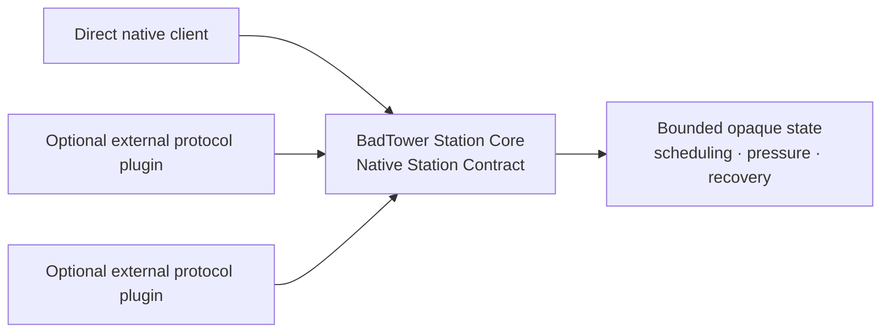

# BadTower Architecture

This document is the top-level design authority for BadTower. It separates
approved destination architecture from current implementation facts.

## Architectural objective

BadTower is a pure protocol-neutral communication Station. Native clients use
one small contract directly; optional external protocol compatibility is added
only after the native Station is complete and never enters the Core process.



The plugin arrows describe an external process boundary, not Core imports. The
current source includes one isolated Candidate adapter, but it is quarantined
from production admission while the Native Excellence Gate remains open.

## Approved maturity order

```text
Station Core contract
        ↓
Standalone Station Instance
        ↓ hard completion gate
High-Availability Station Cluster
        ↓ native excellence gate
External Extension Contract
        ↓
independently selected Protocol Compatibility Plugins
```

Later plans cannot become implementation inputs to an earlier stage. In
particular, no protocol plugin is required to prove native communication,
single-node operation, or clustered availability.

## Domain model

| Boundary | Responsibility | Isolation rule |
| --- | --- | --- |
| Station Core | Native contract, opaque transport, state, admission, scheduling, pressure, health, package, recovery, and deployment semantics | Contains no external protocol type, registry, loader, supervisor, or plugin lifecycle |
| Native Station Contract | Reserve, Submit, Claim, Settle, health, capacity, and graceful shutdown | Directly usable; fixed protocol-neutral fields only |
| Station Instance | One independently operable Core member | Completes before cluster work; needs no plugin |
| Station Cluster | Multiple replaceable Core members representing one logical Station | Preserves the accepted native contract and owns only infrastructure distribution |
| External Extension Contract | Deferred descriptor, scoped native access, harnesses, minimal SDK, package and evidence conventions | Separately packaged; reuses but does not widen the native contract |
| Protocol Compatibility Plugin | External process implementing one exact external protocol contract | Own listener, code, state, limits, artifact, lifecycle, support, and operation; absent by default |

## Native communication flow

```text
Reserve Station Address
        ↓
Submit opaque Transport Unit
        ↓
Claim bounded ordered batch
        ↓
Settle complete or release
```

The Core's durable entities are Station Namespace, Station Address, Transport
Unit, Delivery Claim, Settlement Record, and Capacity Profile. Each declares
its key, lifetime, consistency, durability, recovery, capacity charge, and
deletion rule.

The native contract deliberately does not model agents, tasks, tools,
resources, prompts, sessions, federation members, external protocol versions,
endpoint identities, cryptographic state, or business acknowledgements.

## Core safety and performance invariants

1. **Plugin-free closure.** Build, tests, startup, direct communication,
   readiness, backup, restore, and shutdown use no production plugin.
2. **Fixed native schema.** Arbitrary key-value protocol metadata cannot enter
   Core APIs or persistent state.
3. **Atomic replay safety.** Idempotency and deduplication records commit in
   the same consistency boundary as their guarded mutation.
4. **Fenced ownership.** Every mutable owner carries a monotonic epoch or
   fencing token; stale work cannot commit after transfer or restart.
5. **Bounded work.** Requests, bytes, connections, queues, workers, claims,
   retries, state, cleanup, repair, rebalance, and observation have hard
   ceilings and stable overload results.
6. **Indexed work.** Point lookup is indexed, claim does not scan the complete
   store, and expiry uses an indexed schedule rather than periodic global
   scans.
7. **Fair progress.** A bounded, evidence-backed scheduler prevents one hot
   namespace or maintenance stream from starving another.
8. **Incremental maintenance.** Cleanup, compaction, snapshot, restore, repair,
   and rebalance yield to declared foreground budgets.
9. **Privacy-minimal operation.** Observation excludes payloads, protocol
   content, endpoint identity, credentials, machine identity, and raw runtime
   state.
10. **Evidence-bound optimization.** Performance claims bind one exact
    capacity profile, workload, failure model, candidate, and result schema.

## Station Instance boundary

A Station Instance has one canonical state and scheduling implementation. It
validates package, configuration, schema, permissions, limits, and recovery
state before readiness. Cardinality-one ownership still uses epochs so stale
work after restart fails safely.

The standalone closure includes direct native black-box communication,
durability, capacity, load, soak, fairness, overload, graceful shutdown,
package upgrade, guarded rollback, backup, isolated restore, and recovery.
It contains no membership, replication, quorum, rebalance, or remote failover
implementation.

## Station Cluster boundary

Cluster implementation begins only after the complete standalone gate. It
extends the same native contract with:

- authenticated bounded member lifecycle and fault-domain labels;
- versioned deterministic partition placement;
- explicit per-state consistency, durability, replication, quorum, and loss
  behavior;
- ownership epochs, fencing, atomic idempotency, repair, and failover;
- bounded fair scheduling for foreground, replication, repair, rebalance, and
  maintenance;
- incremental scale-out, scale-in, drain, replacement, and rebalance;
- mixed-version, canary, rolling upgrade, guarded rollback, and schema rules;
  and
- backup, isolated restore, disaster recovery, RPO, RTO, and privacy-minimal
  topology observation.

A Station Cluster is not a protocol federation, agent network, endpoint trust
root, multi-station fleet, or proof of hosted availability.

## External extension boundary

External extension implementation is deferred until the native excellence
gate passes. Its only purpose is to let independent external processes use
the native Station safely and consistently.

The Core never:

- scans for or loads plugin code;
- hosts an in-process extension API;
- registers external protocol names or lifecycle;
- supervises plugin processes;
- stores plugin-specific state;
- inspects plugin descriptors at runtime to change behavior; or
- changes release or support state because a plugin changes.

A deployment supervisor starts and observes each plugin. The plugin connects
as an ordinary scoped native caller. Killing, disabling, saturating, upgrading,
rolling back, or retiring it leaves direct native service and other plugins
unchanged.

## Protocol plugin boundary

The optional planned plugins are LicoArc, A2A, ACP, and MCP. Each has its own
artifact, listener, protocol implementation, config, optional bounded local
state, native namespace, resource budget, metrics, tests, version, release,
support, and operation.

The LicoArc plugin is solely BadTower work. LicoArc supplies general protocol
materials to all implementers but owes no BadTower adapter, validator,
fixture, package, test, fix, release, support, runner, or receipt.

A2A and ACP are distinct plugins. Even though the ACP project has joined A2A,
an explicitly admitted pinned ACP compatibility line uses fresh ACP-local
state and no A2A alias, shared adapter, state migration, dual route, or silent
fallback.

The MCP plugin owns all MCP framing, capability, authorization, method, tool,
resource, prompt, and effect semantics it supports. Core never becomes an MCP
server or tool runtime.

If a protocol feature cannot map safely to the fixed native contract, the
plugin owns the missing behavior or rejects support. It cannot make Core
protocol-aware.

## Current source components

| Component | Current responsibility |
| --- | --- |
| `cmd/badtower` | Loads strict configuration, opens the Station Core, serves gRPC, health, and metrics, and shuts down |
| `cmd/badtowerctl` | Configuration validation, credential generation, and native RPC harness commands |
| `internal/nativeapi` | gRPC Station service, bearer authentication, health, metrics, lifecycle, and `StationFailure` mapping |
| `internal/stationcore` | Pebble-backed Reserve, Submit, Claim, Settle, capacity, scheduling, expiry, idempotency, and lifecycle |
| `internal/stationcluster` | Shared deterministic mutation commands, 64-partition placement, ownership epochs, bounded durable etcd/raft member runtime, restart replay, failover, and mTLS peer transport |
| `api/badtower/station/v1` and `gen/go/badtower/station/v1` | Native Station Contract Protobuf and generated bindings |
| `internal/nodepackage` and `cmd/badtower-package` | Deterministic package, strict manifest, detached signature, bounded verification, and privacy-safe receipt |
| `contracts/extension/v1`, `pkg/extension/v1`, and `tools/extension-harness` | External-only closed descriptor, minimal scoped client conventions, resource budgets, and synthetic isolation harness |
| `internal/pluginpackage` and `cmd/badtower-plugin-package` | External package descriptor generation, deterministic archive, detached signature, bounded verification, and privacy-safe receipt |
| `plugins/licoarc-candidate` | Separate exact LicoArc Candidate process, carrier, mapping, local state, and tests; absent from the Core dependency graph |

The current source implements a native Station Instance candidate and the
static durable consensus foundation of a Station Cluster. Dynamic membership,
rebalance, coordinated recovery, process assembly, and exact Cluster capacity
evidence remain open, so Native Excellence is not accepted. External contract
and exact LicoArc Candidate source is isolated and testable but remains
quarantined from production admission until that gate closes.

## Native migration

The K1-K5 migration replaced the integrated path in one closure:

- introduced the canonical native entities and contract;
- moved no protocol semantics into them;
- initialized fresh current-name state;
- removed the integrated validator, profile selection, protocol fields,
  routes, registry, state names, configuration, fixtures, tests, and docs from
  Core; and
- retained no alias, compatibility facade, dual route, dual schema, dual read or
  write, old-state discovery, or fallback.

The exact LicoArc mapping exists only in a separately packaged external process
and remains production-deferred until Native Excellence is accepted.

Pending destination intent remains in product authority and local plans. An
ADR is not recorded until a durable decision is implemented and verified.

## Current failure model

The native candidate fails closed on invalid configuration, retired data roots,
unknown store identity, authentication failure, malformed IDs, quota and
capacity exhaustion, stale claim epochs, expired addresses and units, clock
unsafe conditions, and overload. Failures map to the closed `StationFailure`
taxonomy and gRPC status codes defined by the native contract.

Current implementation, verification, release, support, and operation remain
authoritative only in [`../STATUS.md`](../STATUS.md).
